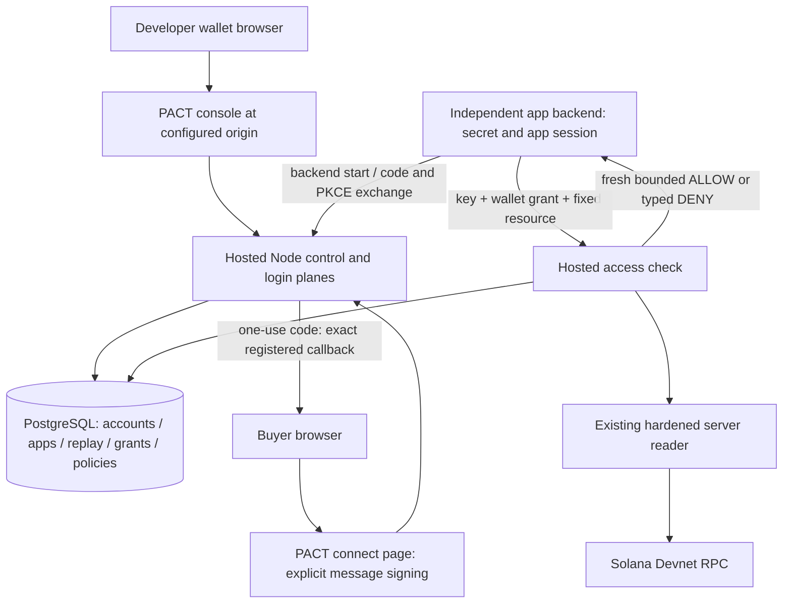

# API-first hosted platform — architecture contract

Date: 2026-10-19. Scope: local implementation for a free, bounded Solana Devnet pilot. This ADR is an engineering decision under the user's implementation authorization; it is not owner approval of hosting, legal terms, public distribution, or a wallet operation.

## Foundation and acceptance

Baseline `57b425f148e65840c23283b4283ce1e22ccb45bd` on `codex/full-development`; independently inspected GitHub run `39017755163` has successful `node-and-browser` and `pinned-chain` jobs. Branch `codex/api-first-integrations` contains checkpoint `9074ddd` preserving the existing generated `web/next-env.d.ts` change. No foundation branch, public deployment, on-chain source, protocol address, account layout or unrelated repository is changed.

The supplied master plan is the feature specification because the user's request explicitly designates it as such. Its illustrative endpoints and domains are proposals, not assertions of existing behavior. Phases progress through tests and independent review; a failed invariant blocks the next implementation phase. Real-wallet, external hosting, remote CI for unpublished commits and operator acceptance remain distinct gates.

## Decision 1: separate hosted model

Create a private `services/pact-api` persistent Node service and provider-neutral PostgreSQL migrations. Use a bounded connection pool and parameterized SQL; migrations and atomic compare-and-consume operations run in transactions on one checked-out client. Do not add Supabase accounts or infrastructure. PGlite may execute real PostgreSQL SQL for local development/tests, including file-backed restart/restore tests; it does not establish multi-process PostgreSQL concurrency or a hosted deployment topology. CI additionally runs real PostgreSQL competing-client tests.

Use the existing `createPlatformReader` public server export for verified offer and entitlement reads and readiness. Keep one lifetime reader with bounded work and retained endpoint history; do not reconstruct the reader per request or weaken its genesis/program/owner/PDA/Clock/freshness checks. Customer-hosted `@pact/sdk/server`, all existing exports and `/api/v1` remain unchanged. No hosted entitlement cache or protocol changes.

The independent backend owns its state, PKCE verifier and HttpOnly session. PACT grants never enter browser storage or URLs. A license decision cannot make a customer database transaction atomic or reclaim delivered bytes. Customer code rechecks at durable commit boundaries and enforces every protected route.

## Decision 2: limited custom authentication, no OAuth claim

Support a deliberately limited, backend-initiated exact-message wallet challenge / single-use code / opaque app grant protocol. This is custom pilot authentication, not OAuth 2.1, OIDC, SIWS conformance or public SSO. A standards-compliant public provider remains deferred until a mature implementation and independent compliance/security coverage exist. Native Node Ed25519 verification is reused as a primitive; the old process-local cookie/Map adapter is not repurposed.

Admin and buyer challenges have separate purposes and include exact issuer/origin, wallet, app/environment where relevant, network, genesis, program, random nonce, issue/expiry and intended action. Store/verifiy exact issued bytes. Short-lived challenges are consumed atomically; failed valid-format signature attempts consume them. Sessions, keys, codes and grants use random opaque values with keyed verifiers in storage. The HMAC pepper must be separately supplied to a secret manager for hosting; local tests use disposable generated values. Never print it. No user wallet secret is handled.

Admin sessions use host-only HttpOnly SameSite=Strict cookies (Secure outside loopback). Every mutation requires exact Origin plus CSRF binding. Sensitive mutations additionally consume a fresh action-specific signature tied to the exact app/action/payload digest, including callback changes, offer bindings, credentials, pause/revoke and privileges. A recent generic login is insufficient. Wallet account recovery is disabled: there is no email recovery or implicit delegation.

Only a key-authenticated backend can initiate a login transaction, supplying an exact verified callback, random state and S256 challenge. The PACT page displays the app and purpose and requires an explicit wallet action. On successful exact signature verification it returns a short-lived code to the registered callback. Code redemption requires app key, the original state, exact callback and PKCE verifier, and atomically consumes the code. The backend checks initiating session state and expected issuer before exchange. Grants bind app/environment/wallet/TTL and are independently revocable. App pause, key revoke and grant revoke are rechecked after asynchronous chain work and immediately before ALLOW.

## Decision 3: registry and policy

PostgreSQL owns developer accounts (unique canonical admin wallet), applications (owner FK, fixed Devnet/program/environment), exact callback registrations and verified domain state, immutable resource keys with versioned offer bindings, API credential metadata/verifiers, challenges/sessions, login transactions, grants, redacted events and bounded usage aggregates. FK, unique and expiry indexes enforce referential integrity. Every object route derives tenant from proven admin or API key; app IDs never grant ownership.

Keys are random server-only bearer credentials with a non-secret identifiable prefix, fixed allowlisted scopes, expiry, last-use and revocation. Secrets are shown once on creation/rotation, absent on listing, never placed in code samples or analytics. Rotation adds a new credential and keeps the old credential until explicit revoke or bounded expiry; revocation remains available while an app is paused. Credential creation and revoke require action-specific admin proof. App pause denies backend access without deleting evidence.

Callback registration accepts exact canonical HTTPS URLs or explicit local loopback HTTP paths. Reject wildcards, fragments, userinfo, query parameters, noncanonical encodings and arbitrary private/IP targets outside loopback. Allowed website origins are exact origins. No callback is fetched. Nonlocal callbacks require a fresh expiring DNS TXT ownership token at a fixed `_pact` label, verified with bounded DNS resolution and a validity window; reverify at login initiation. Domains are subject to hijack; an operator must approve policy before external pilots. No email or arbitrary metadata fetcher is added.

Only an active offer whose verified on-chain seller equals the proven admin may be newly bound. A new signed action binds its canonical address to a server-owned resource; policy changes are versioned/audited, revoke existing grants, and never accept end-user offer overrides. Offer deactivation blocks new purchases/bindings; it does not revoke existing unexpired entitlements. Keep exact agreement bytes with the seller and use existing checkout/buyer links/manual metadata.

## Decision 4: HTTP and topology

The new service owns `/v1`, separate from existing `/api/v1`. Browser console/connect traffic uses the configured PACT origin through a fixed server-only gateway. Backend-key data/token endpoints reject browser Origin/CORS. No wildcard secret-bearing CORS, third-party cookies or browser key storage. The gateway cannot accept a caller-selected target URL. Hostname, TLS and upstream trust are explicit configuration; ignore untrusted forwarding headers. Local default service listens on loopback. One persistent service is the initial support matrix; shared SQL replay tests do not authorize replicas, serverless or distributed RPC history.

Use a maintained HTTP parser/framework with strict schemas, request/body/header/time ceilings, no raw request logs, safe errors and no-store responses. Separate auth/control/access admission pools, bounded per-IP/key/app/route budgets and a small bounded DB pool prevent unbounded queues. Logging contains fixed diagnostic classes/request IDs, no authorization headers, signatures, challenge text, query strings, codes, grants, secrets or terms. Security headers include no-referrer, frame denial and restrictive CSP for connect. Health liveness is cheap; readiness checks DB/schema and verified chain without leaking infrastructure.

## Contract freeze and failure matrix

Detailed runtime request/response schemas live with the service and generate its OpenAPI. All bodies reject unknown fields. No endpoint accepts client-selected program/network or licensing wallet overrides.

| Plane | Minimum contracts |
| --- | --- |
| Admin auth | `POST /v1/developer/auth/challenge`, `/verify`, `/logout`; `GET /session`; separate action proof challenge contract |
| Owned registry | `/v1/developer/apps`, `/apps/:appId`, `/callback-uris` + DNS verify, `/resources`, `/credentials` + rotate/revoke, `/usage`, `/events` |
| Limited connect | backend `POST /v1/connect/transactions`; public transaction display; PACT-origin challenge/verify; backend `/token`, `/revoke` |
| Data | backend `POST /v1/access/check` accepts exactly walletGrant/resourceKey; server derives app/wallet/offer |
| Operational | `GET /v1/health/live`, `/ready`; no public operator metrics |

Every decision envelope is versioned with request ID, bound app/resource/offer/wallet, fixed network/program, read timestamp/context slot and expiry when known. Expected missing/expired license denies with 403; invalid auth 401, malformed input 400, unknown owned object 404, overload 429/503, DB/RPC/auth uncertainty 503. Never return an ALLOW-shaped response after failure. Client adapters validate schema/bindings/freshness and deny unknown responses. Purchase links contain only validated known PACT routes/canonical offers, and state clearly when exact metadata is still required.

## Migration, operations and review gates

Add forward-only numbered SQL migrations with checksums and a transaction/schema-version gate; reject drift and unknown schema versions. Rollback disables hosted routing and returns to the unchanged customer-hosted model; do not destructively downgrade live identity data. Backup/restore in an isolated DB must show app/policy integrity and a new auth epoch/pepper procedure that invalidates restored keys/sessions/grants before serving, preventing revoked credential resurrection.

Retention proposal for private local pilot: delete expired proofs/codes/sessions/grants after one day, usage after 30 days, redacted audit after 90 days, backups after 30 days; owner/legal approval required before external collection. Implement bounded maintenance and explicit pause/delete procedures. Do not claim legal/commercial readiness.

Per-phase tests cover two tenants, exact action proofs, restart/replay, competing SQL consumers, domain/callback attacks, key rotation/revoke races, seller ownership, backend state/PKCE, cross-app grant theft, fresh authorization/expiry/deactivation, RPC/DB outages, limits, secret redaction, examples and actual browser flows. Independent architecture/security/QA reviews accompany each gate. Synthetic RPC/wallet proofs are labeled; remote CI, hosted restore and human wallet/device acceptance remain separate evidence.

Owner decisions before Phase9/10: approved DNS/TLS and hosting/database scope, secret manager, RPC costs, quotas/capacity, operating owner/on-call/contact, domain proof validity policy, privacy/terms/retention/recovery/distribution rights, staging and real-wallet acceptance authorization. No public site overwrite, push, deployment, npm publication, wallet approval, signing or broadcast is authorized.

Review Node security release by **2026-10-21** and dependency exceptions by **2026-11-15** (earlier on new reachability). Do not extend those deadlines to make validation pass.

References inspected: [RFC9700](https://www.rfc-editor.org/rfc/rfc9700.html), [node-postgres transactions](https://node-postgres.com/features/transactions), [PGlite](https://pglite.dev/docs/), [Fastify request bounds](https://fastify.dev/docs/latest/Reference/Server/). These guide engineering; they do not certify this custom protocol.
