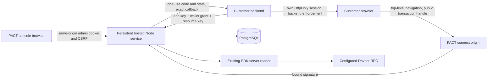

# Hosted integration architecture review

Independent read-only architecture review, 2026-10-19. This is a proposal and evidence record for the Lead Architect's Phase 0 decision, not owner approval for external hosting or an assertion that the proposed service exists.

## Inspected evidence

- Read the complete UTF-8 master plan from `C:/Users/Lehr/Downloads/PACT_API_FIRST_INTEGRATE_YOUR_APP_PLAN.md`, including its endpoint contract section separately after initial terminal truncation.
- Actual inspected baseline: branch `codex/full-development`, HEAD `57b425f148e65840c23283b4283ce1e22ccb45bd`. `git status --short` showed only modified `web/next-env.d.ts` at inspection. Root owns preservation, feature branching and the CI receipt check; this review did not independently establish remote CI success.
- Read root and web `AGENTS.md`, `docs/platform/ARCHITECTURE.md`, `backend-enforcement.md`, `security.md`, `docs/product/RELEASE_CONTRACT.md`, `docs/development/DEVELOPER_GUIDE.md`, `docs/operations/ENVIRONMENTS.md`, `docs/TECHNICAL_DEBT.md`, and `docs/security/dependencies.md`.
- Inspected SDK package/exports and `src/server.ts`, `server-auth.ts`, `server-chain.ts`, `platform-types.ts`, `internal/license-reader.ts`, `internal/reader-pool.ts`, root exports, web package, integration wizard, the existing Next API route, and CI job names.
- `Get-Command` found Node/npm but no `psql`, `postgres`, Docker or Podman. `Get-Service` found no PostgreSQL/Docker services. No established repository SQL migrations or database package were identified. This is workstation discovery, not proof that database binaries cannot be installed locally.

## Recommended topology and scope

Create a private Node service/package separate from the existing Next public API and the SDK customer-hosted handler. Use PostgreSQL through a small SQL adapter and checked-in sequential SQL migrations. Prefer `pg` with parameterized statements and one-client transactions over an ORM/auth framework plus multiple new dependency graphs. Confirm and pin actual registry versions, audit the resulting graph, and validate TLS/pool/timeouts before use.

Run one persistent Node process for the initial pilot, with a deliberately configured canonical PACT origin, explicit trusted gateway policy, request limits and private RPC. PostgreSQL carries durable principals, challenges, sessions, code consumption and grants. The service must reject unsupported serverless/replica modes; testing two database consumers proves atomic one-use operations, not safe distributed chain freshness or admission behavior.

Keep the developer console in existing Next UI. Either route same-origin browser endpoints through an explicitly trusted gateway to the Node service, or navigate to service-owned control/connect pages. Do not silently broaden admin-cookie CORS or forward arbitrary origins/hosts. The reverse-proxy arrangement and cookie path must be fixed before UI integration. A customer-facing API origin and PACT browser origin can differ only with a specified server-side trust bridge; the initial arrangement should use one public hosted origin.

No remote PostgreSQL/Supabase account, domain, DNS change, hosting provider or live PACT deployment is selected by this local architecture. Add local loopback examples and test fixtures only. Do not change on-chain layouts, program IDs, transaction semantics or Base fallback.

## Preserve and reuse

| Existing component | Safe reuse | Boundary |
| --- | --- | --- |
| `@pact/sdk/server` `createPlatformReader` | Lifetime server reader: `getOffer`, `getLicenseStatus`, `readiness`; pinned program/genesis/account/PDA validation | Instantiate once, never per request; retain history and bounded cancellation. Do not replace with raw RPC decoding or public `valid` results. |
| `@pact/sdk` `isLicenseStatusFresh` | Recheck positive status immediately before returning decision | It is not a wallet proof or a replacement for a fresh read. |
| Existing Ed25519 `server-auth.ts` logic | Exact-message/native-crypto verification pattern | Existing challenge/session maps and same-origin cookie flow remain unchanged. New hosted schema/message domain must distinguish admin, sensitive admin action and buyer login. |
| Marketplace, checkout, buyer links and manual metadata | Continue direct purchase in existing wallet UX | Service never signs/broadcasts. Offer commitment cannot reconstruct metadata; no invented hosted terms. |
| `/api/v1`, `@pact/sdk/v1`, original wizard | Existing public lookup/preparation/customer-hosted option | Hosted `/v1` is a distinct versioned contract; no route takeover or silent cookie/auth conversion. |

The public reader factory has a maximum of eight active reads and sixteen queued reads, five-second deadlines, eight-second read-age and twelve-second progress freshness. Existing handler partitions public/protected pools internally and shares history. The hosted service should reserve its reader for key-authenticated/admin operations and use admission classes so readiness/admin reads cannot starve protected checks. Do not add a new unbounded public hosted read surface. Any additive SDK factory exposing shared history/pool partitioning requires compatibility tests; importing unpublished SDK source internals is not a supported distribution boundary.

Deactivated offer means no new purchases, not revoked existing entitlements. A fresh binding requires an active offer; a previously bound resource must still allow an existing unexpired license after deactivation. Preserve this distinction in tests.

## Login decision: limited custom private-pilot protocol

Use a narrowly scoped **backend-mediated wallet challenge/code/grant protocol**, explicitly not OAuth, OAuth 2.1, OIDC or general SSO. Do not add discovery, refresh tokens, third-party cookies or broad public client compatibility. This permitted master-plan fallback avoids inventing standards-conformance claims. Native Ed25519 verifies message signatures; hashes and opaque random tokens handle state. Independent security review remains a release gate.

Freeze the following protocol before shared interfaces:

1. Customer backend creates a transaction with its API credential, exact registered callback, random session-bound `state` and PKCE S256 challenge. State and verifier stay in that customer's server-side login session. Require canonical 43-character base64url SHA256 challenge and RFC7636 verifier grammar/length. No `plain` method.
2. Return only a high-entropy public transaction handle and a PACT-origin connect URL. The transaction is app/environment/callback/state/PKCE bound with a short expiry. Never accept an unsigned caller-selected app/wallet as authenticated identity.
3. PACT top-level connect page establishes a browser binding cookie and requests a deliberate wallet signature over exact bytes containing protocol version, issuer/origin, app/purpose, Devnet genesis/program, wallet, transaction ID, nonce/binding and issued/expiry. No transaction request. A changed wallet requires a new challenge.
4. Consume the bound challenge atomically; verify the signature and issue a single-use opaque code. Return code, original state and issuer to the exact stored callback. Avoid third-party scripts, access-log queries, analytics/referrer leakage. Code is front-channel; grant and API key never are.
5. Backend validates its own initiating state and issuer, then exchanges code using its app key, exact callback and PKCE verifier. One SQL transaction conditionally consumes unexpired code and inserts grant. Competing exchanges produce exactly one grant. Failed verifier/client validation must not enable a second success or cross-app exchange.
6. Return an opaque hashed-at-rest, short-lived app/environment/wallet grant. Customer backend keeps grant in its server-controlled session; browser gets only its own HttpOnly cookie. Logout revokes grant and clears app session. PACT cannot detect off-site wallet-disconnect events; no instant-disconnect claim.

Recommended bounded defaults: challenge two minutes, login transaction five minutes, code one minute, admin session fifteen minutes, sensitive-action proof two minutes and buyer grant fifteen minutes; hard expiry, no refresh. Exact values belong in tested config, not arbitrary caller inputs. Local HTTP is loopback-only; HTTPS cookies are Secure/HttpOnly with narrowly scoped paths and appropriate same-site controls. Connect redirects need not transmit a PACT cookie back to the customer.

## Persistence and tenant decisions

- UUID/random opaque IDs; canonical public wallet identity unique per developer account, no implied email identity/recovery/delegation. Account recovery is a human policy gate. No private wallet credentials stored.
- `developer_accounts`, `developer_applications`, `callback_uris`, `app_resources`, `resource_versions`, `api_credentials`, `admin_challenges`, `admin_sessions`, `action_proofs`, `login_transactions`, `wallet_challenges`, `wallet_grants`, `security_audit_events`, `usage_aggregates` plus bounded quota state as required. Do not create a general legal-agreement or metadata database.
- Tenant comes from a proven admin session or API key lookup. Every subsequent object query includes owner/app/environment conditions; composite foreign keys prevent cross-app joins. Missing and unowned IDs return indistinguishable 404 where appropriate.
- Credentials contain at least 32 random bytes plus a nonsecret key identifier/prefix. Store HMAC-SHA256 verifiers with an operator-owned stable secret supplied out-of-band, or document SHA256 of uniformly random 256-bit credentials if avoiding a second secret; never hash human passwords this way. Use fixed-size constant-time comparison. Last-use/expiry/scopes/revocation in database. Rotation creates overlap explicitly; revocation takes effect before another access decision.
- Use `UPDATE ... WHERE consumed_at IS NULL AND expires_at > ... RETURNING` or locked-row transactional consume, and perform grant/session creation in the same transaction. All statements in a transaction must use the same checked-out client. TTL cleanup is maintenance, never security authority.
- Revalidate key, app, resource version and grant after asynchronous chain work before returning an ALLOW to close revoke/pause/rebind races. A successful grant never caches entitlement. No local positive entitlement cache.
- Retention needs bounded defaults and operator runbooks: expired challenges/codes/sessions/grants purged after operational grace; redacted audit retention separate from coarse usage. Do not claim deletion erases chain addresses or all backups. Backups/restore tested locally; external policy owner approves retention/disclosure.

## Callback/domain policy

Store canonical exact callback bytes; reject credentials, fragments, wildcards, controls, ambiguous percent/dot/backslash encodings and unbounded URL/query lengths. Prefer no callback query until an explicit use case is reviewed. HTTPS nonlocal callbacks require hostname ownership proof and approved matching website origin. Local callbacks must use exact registered loopback host/port/path; no blanket localhost wildcard.

Use DNS TXT proof with a fresh server-generated token scoped to app, hostname and expiry; query the exact expected record with a bounded trusted resolver and no HTTP/metadata fetch. Resolve no arbitrary internal URL. Domain proof establishes hostname control, not legal identity. Reverify before enabling callbacks and periodically expire authorization; callback/domain changes require a fresh scoped admin proof, audit and invalidation of pending login transactions. Unverified domains remain draft and cannot receive codes. DNS provider/timeout/revalidation policy needs operator approval before hosting; localhost fixtures bypass domain proof only in explicit local/test profiles.

## Minimum HTTP contract to freeze

All hosted responses carry a generated request ID and `Cache-Control: no-store`; request/response schemas reject unknown policy-selection fields. Stable versioned error envelope contains fixed codes and safe messages, never raw exceptions/SQL/RPC URLs/proofs. No permissive CORS on key-bearing routes. Browser operations require exact configured Origin/CSRF/binding; absent Origin is allowed only on authenticated server-to-server endpoints.

| Endpoint family | Principal | Authority |
| --- | --- | --- |
| `/v1/developer/auth/challenge`, `/verify`, `/session`, `/logout` | PACT-origin bound admin signature/session | Account identity only; no buyer entitlement |
| `/v1/developer/apps` plus callbacks/resources/credentials/usage/events | Owner session; fresh scoped proof on sensitive mutation | Exact owned app only |
| `/v1/connect/transactions` | App key with login scope | Start login for its own enabled callback |
| `/v1/connect/challenge`, `/verify` | PACT browser binding and transaction | Establish wallet proof, issue one-use code |
| `/v1/connect/token`, `/revoke` | App key with login scope | Own app code/grant only |
| `/v1/access/check` | Key with access scope + own wallet grant + resource key | Server derives wallet, program and registered offer |
| `/v1/health/live`, `/ready` | Operationally bounded | Readiness, never entitlement/security certification |

Expected status policy: 400 strict input error, 401 invalid credentials/grant, 403 known license/policy denial, 404 unknown/unowned object, 409 stale configuration/proof conflict, 429 quota, 503 database/RPC/freshness/overload. `ALLOW` only for HTTP 200 strict schema with version, request ID, app/resource/version/offer/wallet, network/program, context slot, chain time, expiry and verification time. Return decimal-string chain integers. Never allow because `response.ok` alone, unknown enum/fields, a browser boolean or an unsigned prepared transaction. Denials may carry a safe marketplace link with registered offer, preserving manual metadata requirements.

## Failure matrix and verification gates

| Condition | Required result/test |
| --- | --- |
| DB absent/timeout/restart | Deny or 503; no process-local bypass; persisted sessions remain valid only if their hard expiry/revocation allows |
| Two connections redeem same challenge/code | Exactly one success, verified against real PostgreSQL with independent clients |
| Key/grant revoke, app pause or policy update during RPC | Final revalidation denies stale in-flight decision |
| Invalid seller, wrong owner/app/env/resource/program/genesis | Deny without offering arbitrary substitution |
| Offer deactivation with existing active entitlement | Allow existing valid entitlement, deny new registration/purchase semantics appropriately |
| RPC timeout/backward/frozen/malformed/wrong owner | Existing reader fails closed; no alternate provider search for a positive validation |
| Login state/code/verifier/callback/issuer mismatch | Deny, no grant leakage, no open redirect; no permissive CORS |
| Metrics/audit sink fails | Never change an access result to ALLOW; secret-safe bounded telemetry and maintenance |
| Flood, large JSON/URL/header, disconnected client | Bounded HTTP/DB/RPC capacity and no unbounded queue; global/application/class fairness |
| Secret leak attempt | Assert credential/grant/proof absent from logs, URLs, dashboard lists, generated browser artifacts and source maps |

Real PostgreSQL is necessary for migration, locking/race, failure/restart and restore evidence. `pg-mem`, mock stores or a single-connection WASM database can supplement unit tests but cannot establish two independent PostgreSQL clients or process guarantees. A portable local PostgreSQL binary is a permitted implementation option if no container daemon exists; versions, hashes and local-only bind/auth must be recorded. Never introduce production service credentials to unblock tests.

Phase 0 exit is conditional on root freezing the topology, SQL schema/ownership queries, endpoint/runtime schemas, challenge/code messages and migration/test tooling in the ADR. This review supports that conservative design, not implementation or security signoff. Remaining owner gates: approved hostname/TLS/provider/secret store/RPC cost, operator/on-call/incident contact, domain proof policy, privacy/deletion/account recovery, distribution/legal terms, real human Phantom/device acceptance. Remote CI for new work is impossible to claim without a separately authorized push/run; preserve that distinction.

Track **2026-10-21 Node security review** and **2026-11-15 dependency-exception reassessment** in the new service release gates. Adding `pg` or a hosted HTTP surface immediately triggers dependency reachability reassessment rather than extending exceptions unchanged.

## Primary references actually opened

- [RFC 9700](https://www.rfc-editor.org/rfc/rfc9700.html): exact registered redirects, session-bound CSRF state, PKCE and issuer binding inform the limited protocol. This design is not a standards conformance claim.
- [node-postgres transactions](https://node-postgres.com/features/transactions): transaction statements use one client, not arbitrary pool queries.
- [PostgreSQL UPDATE](https://www.postgresql.org/docs/current/sql-update.html): conditional update and `RETURNING` support atomic compare-and-consume.
- [Solana messages and auth](https://solana.com/docs/frontend/messages-and-auth): message proof is separate from transaction approval.

## Final local integration review

The architecture reviewer independently inspected the final clean hosted summaries at `ead5ba0`: all20commands pass; console16/connect12 have zero skips/errors; the production artifact has67files, `sourceDirty:false`, actual HTTP smoke and `container:not-executed`. Git confirms unchanged protected SDK/chain/contracts/original examples, foundation branch57b425f and the report's exact four-file606→ac1949e delta. These are inspected receipts, not a claim that this reviewer executed every lane.

No new consequential implementation/report defect was identified. Limited custom pilot authentication, one-process/trusted-clock/volume assumptions and unsupported public SSO/replicas remain explicit. Actual remote CI, Docker, provider/real-wallet acceptance and rollout remain unclaimed. Closeout requires independent QA's actual remaining legacy receipts to replace pending reconciliation; root owns that final integration and must not relabel the earlier failed aggregate run.
